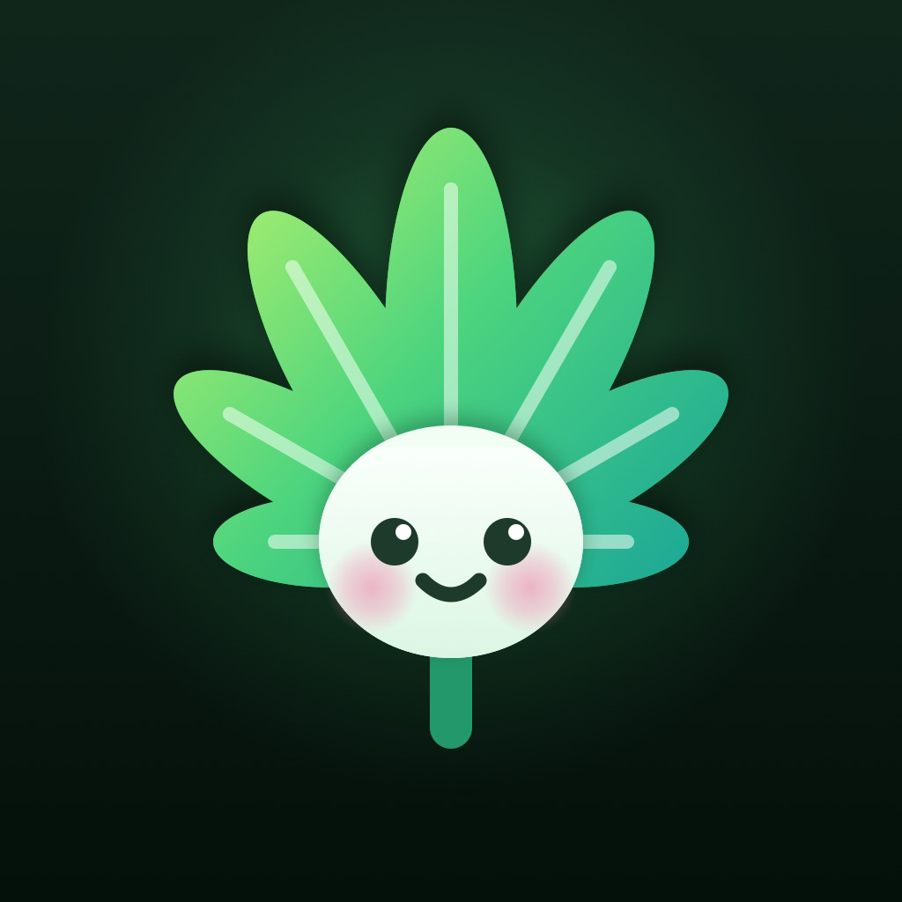
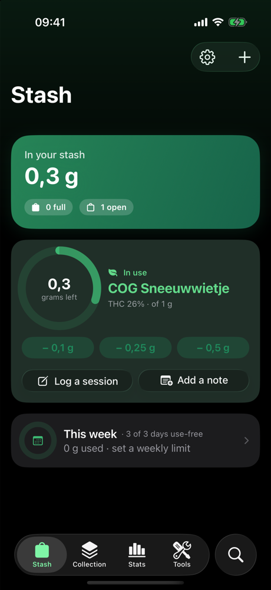
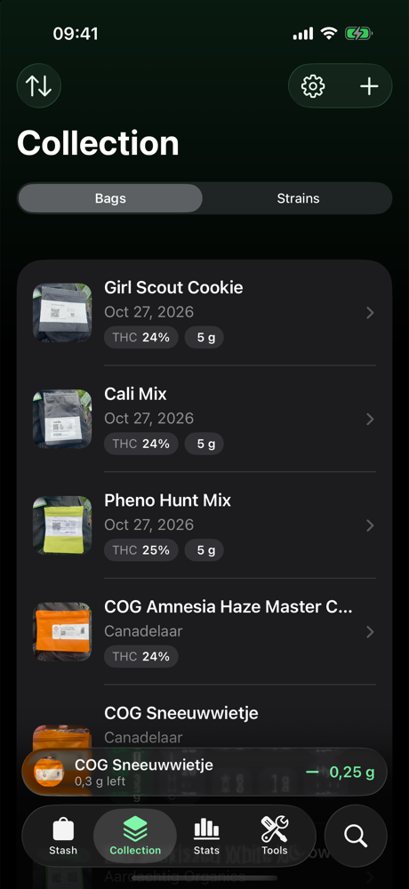
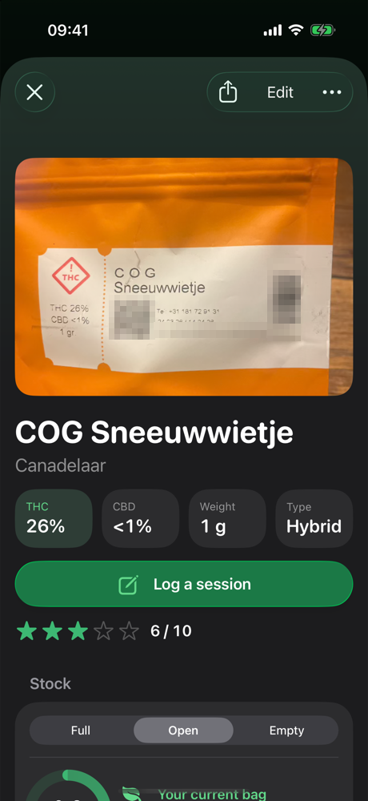
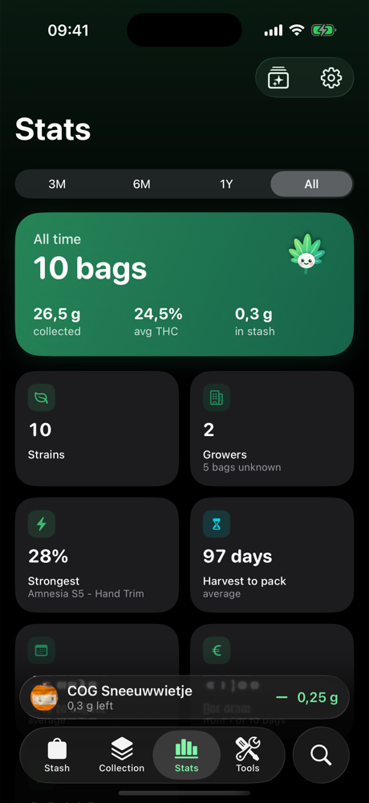
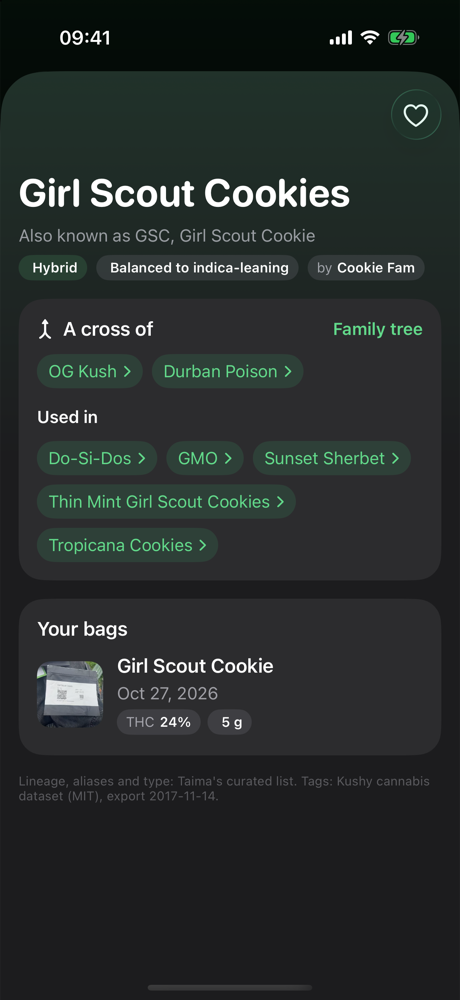
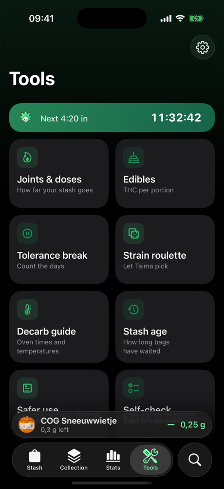
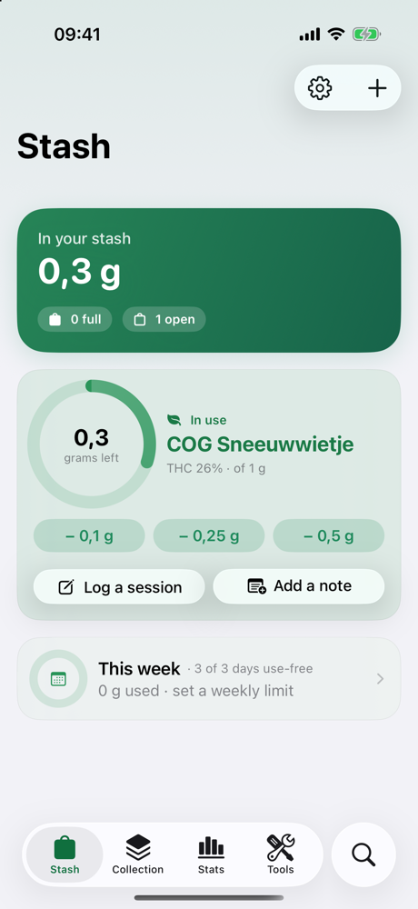
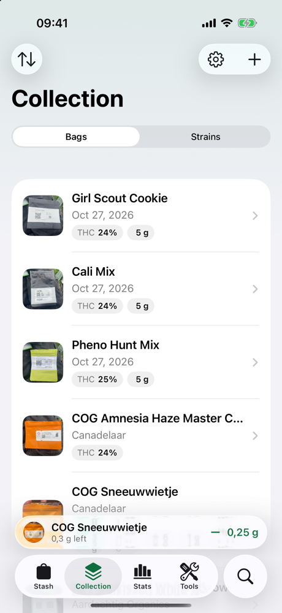

<p align="center"></p>

<h1 align="center">Taima</h1>

<p align="center">
  <strong>A private home for the cannabis you collect.</strong>
</p>

<p align="center">For iPhone on iOS 26 or later. Free and open source, with no account and no tracking. Sideloaded with SideStore or iloader.</p>

<table>
  <tr>
    <td align="center"><br><sub>Stash</sub></td>
    <td align="center"><br><sub>Collection</sub></td>
    <td align="center"><br><sub>A bag</sub></td>
    <td align="center"><br><sub>Stats</sub></td>
  </tr>
  <tr>
    <td align="center"><br><sub>Strain library</sub></td>
    <td align="center"><br><sub>Tools</sub></td>
    <td align="center"><br><sub>Stash, light</sub></td>
    <td align="center"><br><sub>Collection, light</sub></td>
  </tr>
</table>

<p align="center">Shown with a real collection from the Dutch regulated experiment.</p>

Taima keeps track of the bags, prerolls, jars and hash you buy from Dutch coffeeshops in the [closed coffeeshop chain experiment](https://www.rijksoverheid.nl/onderwerpen/experiment-gesloten-coffeeshopketen-wietexperiment) (the *wietexperiment*). Photograph a label and Taima reads it on your iPhone. You check the values, and from then on your collection, your stash and your notes stay on your phone.

## What it does

- **Reads labels on your iPhone.** Strain, THC and CBD, weight, harvest and packing dates, the track-and-trace product code, SKU, EAN, leaflet link, product type, preroll count and the grower. Taima straightens and crops the photo, reads it, and marks every value it filled in so you can check it. A back-of-bag photo fills in what the front missed.
- **Rotate to scan.** For preroll tubes and jars, turn the label slowly in front of the camera. Taima reads every side, combines what it sees and keeps the clearest frame.
- **Do I have this?** Point the camera at a bag in the shop. Taima tells you whether you already have this exact package, or how you rated the same product or strain before.
- **Tracks your stash.** Mark bags full, open or empty and log what you use: an amount, a preroll, or a whole session with method, mood before and after, and notes. Repeat your last session in one tap. The bag in use rides along on the Lock Screen as a Live Activity, and a Home Screen widget logs too.
- **Timed notes.** Write how a session is going, with an optional photo, and see it on the bag's timeline.
- **Stats and insights.** Collected per month, THC spread, growers, sizes, harvest-to-pack time, spending by shop, when and how you use, a calendar of days with and without use, what you collected on this day in earlier years, and plain findings from your own scores and tags. Patterns, never causes.
- **A strain library.** Over 9,000 strains, with curated lineage, aliases and crosses (each with its source), a family tree, a want-to-try list, and your own bags of each strain.
- **Tools.** Joints and THC per joint, edible portions with a wait timer, a tolerance break counter with savings, stash age, a decarb guide, safer-use tips and an optional private self-check.
- **Party games.** A roulette for a strain, a way to smoke and a game, each one optional, and a deck of 157 cards in English and Dutch with your friends' names on them: challenges, duels, votes, charades, debates, table rules and mini-games like Bim Bam Baap. Passing is always fine, and nothing is logged against your stash.
- **Yours, privately.** Face ID lock, discreet mode with a plain icon, encrypted backups and daily automatic backups to a folder you choose. Widgets, a Control Center button, Siri shortcuts and Spotlight respect discreet mode.

## Install

Taima isn't in the App Store. You install it yourself with a free Apple ID. Two tools work; SideStore also keeps Taima up to date.

Taima and its widget use two App IDs. A free Apple ID can register 10 App IDs a week and keep 3 sideloaded apps active.

### SideStore (recommended)

1. Set up SideStore on your iPhone with its [official guide](https://docs.sidestore.io). It needs a computer once, then works on the phone.
2. In SideStore, open **Sources**, tap **+** and add:
   ```
   https://raw.githubusercontent.com/lammersbjorn/taima/main/sidestore/source.json
   ```
3. Open the Taima source and tap **Get**.
4. Open Taima. If iOS asks, trust the developer under **Settings ▸ General ▸ VPN & Device Management**, and turn on **Developer Mode** under **Settings ▸ Privacy & Security**.

New versions show up in SideStore under **My Apps**, and Taima also tells you when one is out. Install updates over the existing app.

### iloader

1. Download `Taima-<version>.ipa` from the [latest release](https://github.com/lammersbjorn/taima/releases/latest).
2. Get [iloader](https://github.com/nab138/iloader) from its official page, connect your iPhone by USB and sign in with your Apple ID.
3. Choose **Import IPA** and pick the file.
4. Trust the developer and turn on Developer Mode as in step 4 above.

To update, repeat with the new IPA. Taima's notice and the release page say when there is one.

### Keep it running

- **Refresh every 7 days.** A free Apple ID signs apps for a week. After that Taima won't open until you refresh it in SideStore, or reinstall with iloader. Nothing is deleted. Taima reminds you the day before.
- **Install over the existing app. Never delete it first.** Deleting Taima deletes everything in it.
- **Keep a backup.** Settings can save an encrypted backup every day to a folder you choose.

## Your data

Everything you record stays on your iPhone. There is no account, no analytics and no server.

Taima reaches the network for one thing: an optional daily update check, which downloads two public files from this repository (the release list and the strain library) and sends nothing about you. You can turn it off in Settings. Sharing a label sample to improve reading is off by default; when you turn it on, you see exactly what would be shared and choose where it goes. Read the [privacy policy](PRIVACY.md) for details.

## What Taima can tell you

- **Label reading can be wrong.** Always check the values Taima marks as read from the label.
- **The strain library describes strains in general, not your bag.** Genetics and effects vary by grower and batch, and lineages marked "reported" are disputed.
- **Insights are patterns in your own records, not causes.**
- **Taima is not medical advice.** The tips follow [Trimbos](https://www.trimbos.nl) guidance, and the self-check is a screen, not a diagnosis. For questions or worries, call the Drugs Infolijn on 0900-1995 or visit [drugsinfo.nl](https://www.drugsinfo.nl).
- **Taima is for adults, 18 and over.** It doesn't sell or source anything; follow the law where you live.

## Build from source

You need a Mac with Xcode 26 or later and [XcodeGen](https://github.com/yonaskolb/XcodeGen).

```sh
xcodegen generate                         # creates Taima.xcodeproj from project.yml
(cd Packages/TaimaCore && swift test)     # label reading, storage, stats and backups
scripts/build-ipa.sh                      # an unsigned IPA in build/, ready for SideStore
python3 scripts/validate-strains.py       # strain library schema, aliases and sources
```

The strain library merges curated facts (lineage, aliases, breeders, each with a source in [docs/research/strain-sources.md](docs/research/strain-sources.md)) with community tags. It ships with the app and updates through `scripts/publish-library.py`.

The app is SwiftUI on a pure Swift core (`Packages/TaimaCore`) with explicit SQLite. Label-reading accuracy per field is tracked in [docs/LABEL_EVALUATION.md](docs/LABEL_EVALUATION.md); fixtures hold recognised text only, with made-up product codes. Data formats are documented in [docs/DATA_FORMAT.md](docs/DATA_FORMAT.md), and maintainers can follow [docs/RELEASING.md](docs/RELEASING.md).

## Contributing

Bug reports, label samples and pull requests are welcome; see [CONTRIBUTING.md](CONTRIBUTING.md). Sharing a label Taima misread is the most useful contribution: it becomes a test case and better reading reaches everyone.

## Credits

- **Luca** came up with the idea for Taima and tested every build. Thank you.
- **Built by** [Bjorn Lammers](https://github.com/lammersbjorn), with the design language of [Saiko](https://github.com/lammersbjorn/Saiko).
- **Community strain data:** the [Kushy cannabis dataset](https://github.com/kushyapp/cannabis-dataset) (MIT). Lineage and aliases are curated by Taima.
- **Harm-reduction guidance:** [Trimbos Institute](https://www.trimbos.nl).
- **Self-check:** the CUDIT-R, by Adamson et al. (2010), *Drug and Alcohol Dependence* 110: 137–143.
- **Growers and brands** named in the app belong to their owners. Taima is not affiliated with any grower, coffeeshop or the Dutch government.

See [THIRD_PARTY_NOTICES.md](THIRD_PARTY_NOTICES.md) for the licences.

## License

Taima is free software under the [GNU General Public License v3.0](LICENSE).
